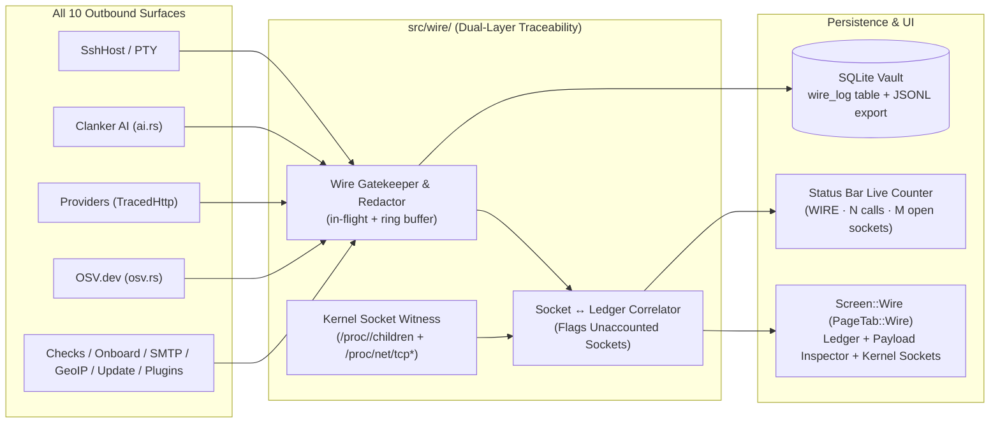

# Outbound Wire & Egress Traceability (`ERR-211`..`ERR-218`)

**Date:** 2026-11-04
**Status:** Scoped & Ticketed (`ERR-211`..`ERR-218`)
**Theme:** *"Don't just promise privacy and security — prove every byte that leaves this machine."*

---

## 1. Executive Summary & Philosophy

Most infrastructure and AI-enabled desktop tools ask the operator to trust that they only talk to the servers and APIs they claim to. Crow takes the opposite stance: **total, verifiable outbound transparency ("900% Traceability")**.

Every single network call Crow makes to any IP, hostname, server, bastion, cloud provider, AI model, vulnerability database, SMTP relay, DNS resolver, or update endpoint is:
1. **Intercepted & Recorded at the Gate (`src/wire/mod.rs`):** Every outbound transport (`SshHost`, `TerminalSession`, `OnboardProbe`, `Clanker AI`, `Cloud Providers`, `OSV.dev`, `External Checks`, `SMTP Email`, `GeoIP`, `Release Updater`, and `External Plugins`) records a structured `WireEvent` with exact destination, resolved IP, port, protocol, subsystem caller, duration, bytes sent/received, status, and **full request/response payloads** (with automatic secret redaction so API keys and passwords never appear in plaintext, while every command, script, URL, header name, and AI prompt is 100% visible).
2. **Cross-Checked Against the Linux Kernel (`src/wire/proc_net.rs`):** While Crow runs, a kernel witness walks Crow's process tree (`/proc/<crow_pid>/task/*/children` recursively across `crow`, `ssh`, `curl`, `ssh-keyscan`, and plugin binaries), maps `/proc/<pid>/fd/*` socket inodes against `/proc/net/tcp`, `/proc/net/tcp6`, `/proc/net/udp`, and `/proc/net/udp6`, and correlates every live kernel socket back to its `WireEvent` or `ssh` ControlMaster multiplexing socket. Any socket in Crow's process tree that was not registered through the gatekeeper is flagged as an **`UNACCOUNTED SOCKET`** (`CRIT`).
3. **Persisted & Exportable (`src/vault/db.rs`):** A rolling ring buffer in SQLite (`wire_log` table, secret-redacted) preserves outbound call history across restarts and supports 1-click **JSONL Audit Export**.
4. **Always Visible (`PageTab::Wire` + Status Bar Counter):** A live status-bar indicator (`WIRE · 142 calls · 0 unaccounted`, pulsing when a call is in flight) opens the dedicated top-level **WIRE** page tab from anywhere in the app, complete with a **Global Outbound Silence / Pause** kill-switch.

---

## 2. Complete Inventory of Outbound Surfaces in Crow

| # | Category (`WireCategory`) | Protocol (`WireProto`) | Source Module | Destination & What Leaves the Machine |
|---|---|---|---|---|
| 1 | `Ssh` | `SSH` | [`src/host/ssh.rs`](file:///home/harakiri/dev/rust/crow/src/host/ssh.rs), [`src/host/bootstrap.rs`](file:///home/harakiri/dev/rust/crow/src/host/bootstrap.rs), [`src/security/sessions.rs`](file:///home/harakiri/dev/rust/crow/src/security/sessions.rs) | `<user>@<host>:<port>` (and `via <bastion>` when `jump_host_id` is set). Exact `argv` command, script on `stdin`, `stdout`/`stderr` bytes, exit code, and ControlMaster state. |
| 2 | `Terminal` | `SSH-PTY` | [`src/terminal/launch.rs`](file:///home/harakiri/dev/rust/crow/src/terminal/launch.rs), [`src/terminal/session.rs`](file:///home/harakiri/dev/rust/crow/src/terminal/session.rs) | Interactive `ssh -tt` PTY sessions to `<user>@<host>:<port>`, tracking session start/end and cumulative TX/RX bytes. |
| 3 | `Onboard` | `DNS`, `TCP`, `SSH-KEYSCAN` | [`src/views/onboard/probe.rs`](file:///home/harakiri/dev/rust/crow/src/views/onboard/probe.rs) | DNS lookup (`ToSocketAddrs`), 3s TCP banner read (`TcpStream::connect_timeout`), `ssh-keyscan -T 5 -p <port> <host>`, and initial SSH facts probe. |
| 4 | `Ai` | `HTTPS` | [`src/ai.rs`](file:///home/harakiri/dev/rust/crow/src/ai.rs) | `curl --config -` to configured Clanker provider (`api.anthropic.com`, `api.openai.com`, `api.mistral.ai`, `api.deepseek.com`, etc.). Logs exact model, system + user prompt JSON, response JSON, and redacts `Authorization` / `x-api-key` headers. |
| 5 | `Provider` | `HTTPS` | [`src/providers.rs`](file:///home/harakiri/dev/rust/crow/src/providers.rs) (`TracedHttp` wrapping `CurlHttp`) | Cloud provider API calls (`api.linode.com`, `api.upcloud.com`) for instance listing, power actions, and snapshots. Logs HTTP method, URL, request body, status, and response body; redacts Bearer/Basic tokens. |
| 6 | `Osv` | `HTTPS` | [`src/security/osv.rs`](file:///home/harakiri/dev/rust/crow/src/security/osv.rs) | `https://api.osv.dev/v1/querybatch`, `/v1/query`, `/v1/vulns/{id}`. Proves that only package names, versions, and distro ecosystem are sent — never hostnames or IPs. |
| 7 | `Check` | `HTTPS`, `HTTP`, `TCP`, `DNS` | [`src/checks.rs`](file:///home/harakiri/dev/rust/crow/src/checks.rs) | External HTTP(S) `curl` probes, TCP socket probes (`TcpStream::connect_timeout`), and DNS resolution checks (`ToSocketAddrs`). |
| 8 | `Notify` | `SMTP-TLS`, `SMTP-STARTTLS`, `SMTP` | [`src/notify/email.rs`](file:///home/harakiri/dev/rust/crow/src/notify/email.rs) | Outbound alert emails via `lettre::SmtpTransport` to `<smtp_host>:<port>`. Logs envelope (`From`, `To`, `Subject`, body preview) with SMTP password redacted. |
| 9 | `GeoIp` & `Update` | `HTTPS` | [`src/geoip.rs`](file:///home/harakiri/dev/rust/crow/src/geoip.rs), [`src/update.rs`](file:///home/harakiri/dev/rust/crow/src/update.rs) | Monthly DB-IP Country Lite `.mmdb.gz` download (`download.db-ip.com`) and GitHub release checks/downloads (`api.github.com/repos/errorware/crow/releases`). |
| 10 | `Plugin` | `PLUGIN-EXEC` | [`src/plugin_host/local.rs`](file:///home/harakiri/dev/rust/crow/src/plugin_host/local.rs), [`src/plugin_host/run.rs`](file:///home/harakiri/dev/rust/crow/src/plugin_host/run.rs) | External plugin executions (`crow-plugin-*`), recording the plugin ID, target server/account, stdin request (with secrets redacted), stdout protocol lines, and any child sockets opened by the plugin PID. |

---

## 3. Architecture & Data Model



### 3.1 Core Types (`src/wire/mod.rs`)

```rust
#[derive(Clone, Copy, Debug, PartialEq, Eq, Hash, PartialOrd, Ord, Serialize, Deserialize)]
pub enum WireCategory {
    Ssh,
    Terminal,
    Onboard,
    Ai,
    Provider,
    Osv,
    Check,
    Notify,
    GeoIp,
    Update,
    Plugin,
}

#[derive(Clone, Copy, Debug, PartialEq, Eq, Serialize, Deserialize)]
pub enum WireStatus {
    InFlight,
    Ok,
    Failed,
    BlockedBySilence,
}

#[derive(Clone, Debug, PartialEq, Eq, Serialize, Deserialize)]
pub struct WireEvent {
    pub id: u64,
    pub started_at_ms: i64,
    pub duration_ms: Option<i64>,
    pub category: WireCategory,
    /// "SSH", "SSH-PTY", "HTTPS", "HTTP", "TCP", "DNS", "SMTP-TLS", "SSH-KEYSCAN", "PLUGIN"
    pub protocol: String,
    /// Human caller label, e.g. "dokku.scan", "overview.poll", "ai.explain_logs", "osv.querybatch"
    pub caller: String,
    ///enrolled server name or provider/service name, e.g. "prod-web-01", "Anthropic", "OSV.dev"
    pub target_label: String,
    /// Remote host or IP, e.g. "203.0.113.10", "api.osv.dev"
    pub remote_host: String,
    pub remote_ip: Option<String>,
    pub remote_port: u16,
    /// Optional jump host ("bastion-01 (198.51.100.2:22)")
    pub via_hop: Option<String>,
    /// One-line summary ("POST https://api.osv.dev/v1/querybatch", "ssh root@203.0.113.10 -- sh -c ...")
    pub summary: String,
    /// Full outgoing command / script / HTTP request body (secrets redacted)
    pub request_payload: String,
    /// Full incoming stdout / stderr / HTTP response preview (capped at 16 KB, secrets redacted)
    pub response_payload: String,
    pub tx_bytes: u64,
    pub rx_bytes: u64,
    pub status: WireStatus,
    pub status_detail: String,
    pub child_pid: Option<u32>,
}
```

### 3.2 Automatic Secret Redaction (`src/wire/redact.rs`)
Before any `request_payload` or `response_payload` enters the in-memory ledger or SQLite `wire_log` table:
- `Authorization: Bearer <token>` → `Authorization: Bearer [REDACTED]`
- `x-api-key: <key>` → `x-api-key: [REDACTED]`
- `Authorization: Basic <b64>` → `Authorization: Basic [REDACTED]`
- Dokku base64 `config:set --encoded` values for non-public keys → `<KEY>=[REDACTED_BASE64]`
- User password stdin (`chpasswd`, `sudo`, SSH askpass) → `[REDACTED_PASSWORD_STDIN]`
- Everything else (SSH scripts, systemd unit names, OSV package lists, AI prompts, HTTP URLs, response JSON) is preserved verbatim so the operator can verify every character sent.

### 3.3 Kernel Socket Witness (`src/wire/proc_net.rs`)
On Linux:
1. Reads `/proc/<crow_pid>/task/*/children` recursively to collect the full PID tree (`crow` + all `ssh` ControlMaster daemons + active `ssh`/`curl`/`ssh-keyscan`/plugin children).
2. For each PID in the tree, reads `/proc/<pid>/comm`, `/proc/<pid>/cmdline`, and `/proc/<pid>/fd/*` symlink targets matching `socket:[<inode>]`.
3. Parses `/proc/net/tcp`, `/proc/net/tcp6`, `/proc/net/udp`, and `/proc/net/udp6` to map each `inode` to `(local_ip, local_port, remote_ip, remote_port, state)`.
4. Classifies each live socket:
   - **`Accounted(event_id)`:** Matches an active or recent `WireEvent` (by `child_pid`, `remote_ip:remote_port`, or resolved host).
   - **`ControlMaster(server_name)`:** An idle `ssh: <path> [mux]` connection kept warm by Crow's SSH multiplexing.
   - **`Loopback`:** Local `127.0.0.1` / `::1` socket (shown when the "Include loopback" filter is toggled on).
   - **`Unaccounted` (`CRIT`):** Any non-loopback socket in Crow's process tree with no matching `WireEvent` or known `ControlMaster`.

---

## 4. Ticket Breakdown (`ERR-211`..`ERR-218`)

### `ERR-211` — Wire Ledger Core, Secret Redactor & Global Silence Gate (`src/wire/mod.rs`, `src/wire/redact.rs`)
- **Scope:**
  - Create `pub mod wire;` with a thread-safe global ledger (`wire::begin`, `wire::finish`, `wire::record`, `wire::snapshot`, `wire::clear`).
  - Implement caller-context tags (`wire::with_caller("dokku.scan", || ...)` thread-local stack) so every low-level `SshHost::exec` automatically knows which high-level collector or action triggered it (`overview.poll`, `containers.scan`, `dokku.scan`, `topology.posture`, `certs.inventory`, etc.) without changing the `Host` trait signature!
  - Implement `wire::is_silenced()` and `wire::set_silenced(bool)`: when **Outbound Silence Mode** is active, all outbound gatekeepers refuse new network calls immediately with `WireStatus::BlockedBySilence` and log the blocked attempt in the ledger.
  - Implement `redact::scrub_payload` with unit tests covering Bearer tokens, `x-api-key`, Basic auth, password stdin, and base64 secrets.

### `ERR-212` — Kernel `/proc` Process-Tree Socket Witness (`src/wire/proc_net.rs`)
- **Scope:**
  - Implement recursive process-tree walker from `std::process::id()` via `/proc/<pid>/task/*/children`.
  - Parse hex IPv4/IPv6 addresses and TCP states (`ESTABLISHED`, `SYN_SENT`, `CLOSE_WAIT`, `TIME_WAIT`) from `/proc/net/tcp{,6}` and `/proc/net/udp{,6}`.
  - Correlate live sockets against `WireEvent` entries and `SshHost` ControlMaster mux processes.
  - Expose `LiveSocket` list (`pid`, `comm`, `local_addr`, `remote_addr`, `state`, `attribution: SocketAttribution`) + `unaccounted_count`.
  - Unit tests for `/proc/net/tcp` and `/proc/net/tcp6` hex decoding and socket attribution.

### `ERR-213` — SSH, Terminal PTY & Onboarding Probe Instrumentation (`src/host/ssh.rs`, `src/terminal/`, `src/views/onboard/probe.rs`)
- **Scope:**
  - Instrument `SshHost` (`exec_stdin`, `exec_streaming`, `fresh_key_login`, `close_connection`, `approval_agent_for`), `host::bootstrap`, and `security::sessions` to record every SSH invocation with target server name, `user@host:port`, `via_hop` (bastion), exact remote command/script, `stdin` (redacted if password), `stdout`/`stderr`, bytes TX/RX, and duration.
  - Add `wire::with_caller(...)` annotations in `src/app/poll.rs`, `src/app/dokku.rs`, `src/app/containers.rs`, `src/app/overview.rs`, `src/app/topology.rs`, etc. so every SSH call shows its exact subsystem purpose.
  - Instrument `terminal::session` PTY spawn/exit and `views::onboard::probe` (`DNS`, `TCP banner`, `ssh-keyscan`).

### `ERR-214` — HTTPS, Cloud Provider, Clanker AI, OSV, Checks, SMTP, GeoIP, Update & Plugin Instrumentation
- **Scope:**
  - Wrap `CurlHttp` in [`src/providers.rs`](file:///home/harakiri/dev/rust/crow/src/providers.rs) with `TracedHttp` implementing `crow_provider_core::HttpClient` so every Linode and UpCloud API call is captured with method, URL, status, duration, and redacted request/response bodies.
  - Instrument [`src/ai.rs`](file:///home/harakiri/dev/rust/crow/src/ai.rs) (`fetch`) to record every Clanker `/models` and chat completion call with redacted API key headers and full prompt/response bodies.
  - Instrument [`src/security/osv.rs`](file:///home/harakiri/dev/rust/crow/src/security/osv.rs) (`curl_json`, `details`) to record every OSV.dev batch and vulnerability detail request.
  - Instrument [`src/checks.rs`](file:///home/harakiri/dev/rust/crow/src/checks.rs) (`Http`, `Tcp`, `Dns`), [`src/notify/email.rs`](file:///home/harakiri/dev/rust/crow/src/notify/email.rs) (`send`), [`src/geoip.rs`](file:///home/harakiri/dev/rust/crow/src/geoip.rs) (`download`), [`src/update.rs`](file:///home/harakiri/dev/rust/crow/src/update.rs) (`curl`), and [`src/plugin_host/local.rs`](file:///home/harakiri/dev/rust/crow/src/plugin_host/local.rs).

### `ERR-215` — SQLite Vault Persistence & JSONL Audit Export (`src/vault/db.rs`)
- **Scope:**
  - Add `wire_log` table to `VaultDb` (migration-safe `CREATE TABLE IF NOT EXISTS wire_log (...)` capped at the most recent 5,000 events).
  - Persist completed `WireEvent` rows asynchronously off the UI thread and load recent history on startup so the operator can inspect calls from previous sessions.
  - Add 1-click **EXPORT JSONL** action writing `~/.local/share/crow/wire-audit-<timestamp>.jsonl` (or copying path to clipboard) and **CLEAR HISTORY** action.

### `ERR-216` — Top-Level `WIRE` Page Tab & Status Bar Live Indicator (`src/app/page_tabs.rs`, `src/components/status_bar.rs`, `src/components/titlebar.rs`)
- **Scope:**
  - Add `Screen::Wire` and `PageTab::Wire` (`"WIRE"`) alongside `FleetSetup`, `Topology`, and `Settings`, plus entry in the burger menu and command palette (`Ctrl+K`).
  - Add a live **Wire Indicator** cell in `status_bar.rs` showing:
    - Pulsing cyan dot when any outbound call is `InFlight`, green `OK` dot when idle and all sockets accounted for,amber `WARN` when **Outbound Silence** is active, or red `CRIT` if any `Unaccounted` socket is detected.
    - Live counter: `WIRE · {calls} calls · {tx}/{rx}` (and `SILENCED` or `{n} UNACCOUNTED` badge when applicable).
    - Clicking the status-bar cell opens `Screen::Wire` from anywhere in Crow.

### `ERR-217` — Outbound Wire Monitor View & Full Payload Inspector (`src/views/wire/mod.rs`)
- **Scope:**
  - **Top Control & Telemetry Strip:**
    - **OUTBOUND SILENCE / LOCKDOWN** toggle button (`SILENCE OUTBOUND` / `RESUME OUTBOUND`) that immediately blocks or resumes all network traffic across the app.
    - Summary stat cards: **Total Calls**, **In-Flight Now**, **Bytes Sent / Received**, **Live Kernel Sockets** (`Accounted` + `ControlMaster`), and **Unaccounted Sockets** (`0` in green `OK`, `>0` in red `CRIT`).
    - **Per-Destination & Category Breakdown strip:** Quick filter pills with call counts and byte totals for `ALL`, `SSH`, `TERMINAL`, `CLANKER AI`, `CLOUD PROVIDERS`, `OSV.DEV`, `CHECKS`, `SMTP`, `GEOIP / UPDATE`, `PLUGINS`, plus search input (matches IP, hostname, command, URL, or payload text).
  - **Split View / Tabs (`LEDGER` vs `LIVE KERNEL SOCKETS`):**
    - **Outbound Call Ledger Table:** Timestamp, Category badge, Protocol, Caller (`dokku.scan`, `overview.poll`, `ai.explain`, etc.), Destination (`target_label` + `remote_host:port` + `via_hop`), Summary (`argv` / HTTP method+URL), TX/RX bytes, Duration (`ms`), and Status.
    - **Live Kernel Sockets Table (`/proc` Witness):** PID, Process (`crow`, `ssh`, `curl`), Local Address, Remote IP:Port, Kernel TCP State (`ESTABLISHED`, `SYN_SENT`, etc.), and Attribution badge (`ACCOUNTED #142`, `SSH MUX (prod-web-01)`, or `UNACCOUNTED`).
  - **Right-Hand Payload Inspector Drawer:**
    - Clicking any ledger row opens the full inspector showing:
      - Connection routing card: Caller, Target, Remote Host, Resolved IP, Port, Protocol, Bastion Hop, PID, Timestamp, Duration, TX/RX bytes, and Status.
      - **OUTGOING PAYLOAD (Request / Command / Stdin):** Full monospace view with `COPY` button (showing exact SSH script, `curl` request, or AI prompt with `[REDACTED]` markers where secrets were scrubbed).
      - **INCOMING PAYLOAD (Response / Stdout / Stderr):** Full monospace view with `COPY` button.

### `ERR-218` — Localization (`en.ftl`, `es.ftl`, `ja.ftl`) & Verification Suite
- **Scope:**
  - Full English, Spanish, and Japanese translations for all `wire-*` and `page-tabs-wire` keys (`100%` parity verified with `--check-language`).
  - Unit tests for `wire::redact`, `wire::proc_net`, `wire::ledger`, `wire::silence`, and `vault::db::wire_log`.
