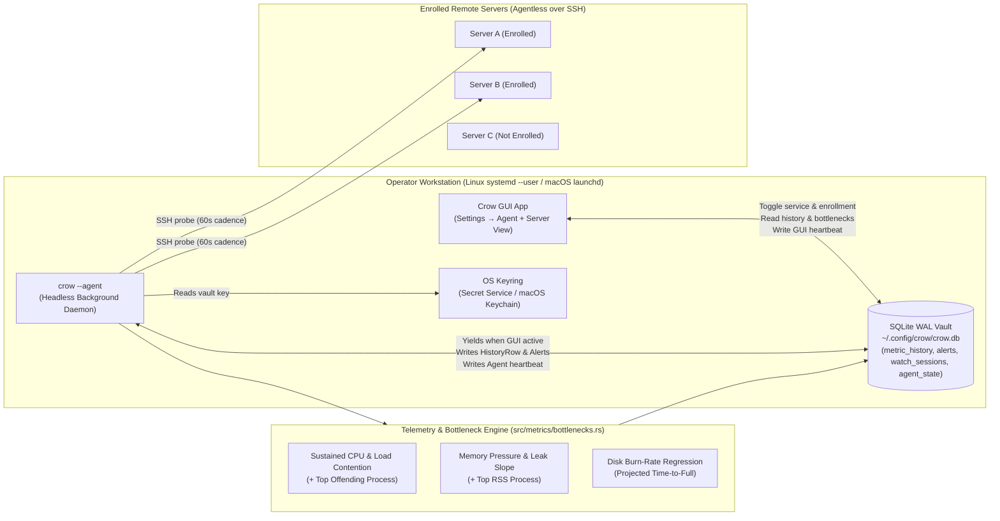

# Epic Specification: Crow Background Agent & Performance Bottleneck Detector (`ERR-203`..`ERR-211`)

**Date:** 2026-11-10
**Status:** Ticketed on Linear (`ERR-203` Epic, `ERR-204`..`ERR-211` Sub-issues)
**Linear Epic:** [ERR-203](https://linear.app/errorware/issue/ERR-203/epic-crow-background-agent-crow-agent-and-performance-bottleneck)
**Theme:** *"Agentless on your servers, always-on on your workstation — continuous telemetry and bottleneck diagnostics even when Crow is closed."*

---

## 1. Goal & Philosophy

Crow's core promise is **zero agents installed on remote Linux servers** — everything happens over plain SSH. However, previously Crow only sampled metrics, recorded 1-minute history rows (`metric_history`), and evaluated alerts while the desktop GUI window was open. Closing the window created blind spots (`gaps`) in the 7-day timeline and meant 3 AM CPU spikes, memory leaks, or runaway disk fills went unnoticed until the next morning.

This epic introduces **`crow --agent`**, a headless background mode built into the existing `crow` binary and managed directly from **Settings → Agent** as a user-level OS service:
- **Linux**: `~/.config/systemd/user/rs.crow.Crow-agent.service` (`systemd --user`, zero `sudo`, 100% safe on immutable/atomic distros like Bazzite and inside Flatpak via `flatpak-spawn --host`).
- **macOS**: `~/Library/LaunchAgents/rs.crow.Crow.agent.plist` (`launchd` user agent via `launchctl`).

Operators can choose **which machines to enroll** either globally from **Settings → Agent** or individually from **each server's view / settings**. While running in the background, `crow --agent` samples enrolled servers over SSH, coordinates with the GUI via SQLite WAL so servers are never double-polled when the window is open, writes continuous history to `crow.db`, and runs a new **Performance Bottleneck Analyzer** that flags sustained CPU saturation, load contention, memory creep/leaks, and disk burn-rate projections.

---

## 2. Architecture

---

## 3. Linear Ticket Breakdown (`ERR-203`..`ERR-211`)

| Ticket | Title | Scope |
|---|---|---|
| **[`ERR-203`](https://linear.app/errorware/issue/ERR-203/epic-crow-background-agent-crow-agent-and-performance-bottleneck)** | **Epic:** Crow background agent (`crow --agent`) & performance bottleneck detection | Umbrella epic tracking the headless user service, selective fleet enrollment, GUI/Agent heartbeat coordination, and performance bottleneck engine. |
| **[`ERR-204`](https://linear.app/errorware/issue/ERR-204/vaultdb-per-server-agent-enrollment-and-guiagent-heartbeat)** | `VaultDb`: per-server agent enrollment & GUI/Agent heartbeat coordination state | Wire per-server enrollment on [`ServerRecord`](file:///home/harakiri/dev/rust/crow/src/vault/db.rs) (`agent_installed` + `set_server_agent_enrolled` + bulk enrollment helpers) and add an `agent_state` table in [`src/vault/db.rs`](file:///home/harakiri/dev/rust/crow/src/vault/db.rs) tracking `gui_last_tick`, `agent_pid`, `agent_started_at`, `agent_last_tick`, `last_polled_servers`, and `last_error` so GUI and daemon coordinate without double-polling. |
| **[`ERR-205`](https://linear.app/errorware/issue/ERR-205/metrics-performance-bottleneck-analyzer-cpu-saturation-load-contention)** | Metrics: performance bottleneck analyzer (CPU saturation, load contention, memory creep, disk burn-rate) | Analyze rolling `HistoryRow` windows and live process snapshots in `src/metrics/bottlenecks.rs` and [`src/metrics/alerts.rs`](file:///home/harakiri/dev/rust/crow/src/metrics/alerts.rs): 1. `bottleneck:cpu` — Sustained CPU $\ge 85\%$ (`WARN`) / $\ge 95\%$ (`CRIT`) for $\ge 3$ consecutive samples, annotated with top CPU process. 2. `bottleneck:load` — Sustained `load1` exceeding $1.5\times$ (`WARN`) / $2.5\times$ (`CRIT`) logical cores. 3. `bottleneck:mem` — Sustained RAM $\ge 88\%$ (`WARN`) / $\ge 95\%$ (`CRIT`) or steady upward memory creep ($\ge +15\%$ over 6h without drop), annotated with top RSS process. 4. `bottleneck:disk_rate` — Linear regression over recent disk samples projecting full disk within $\le 7$ days (`WARN`) or $\le 48$ hours (`CRIT`). |
| **[`ERR-206`](https://linear.app/errorware/issue/ERR-206/agent-cross-platform-user-service-manager-for-linux-systemd-user-and)** | Agent: cross-platform user service manager for Linux (`systemd --user`) and macOS (`launchd`) | Install, uninstall, start, stop, and query status of the user-level background service in `src/agent/service.rs` with zero root privileges: - **Linux**: `~/.config/systemd/user/rs.crow.Crow-agent.service` (`systemctl --user`, Flatpak-aware via [`src/sandbox.rs`](file:///home/harakiri/dev/rust/crow/src/sandbox.rs)). - **macOS**: `~/Library/LaunchAgents/rs.crow.Crow.agent.plist` (`launchctl bootstrap` / `bootout` / `print`). |
| **[`ERR-207`](https://linear.app/errorware/issue/ERR-207/agent-headless-crow-agent-and-agent-once-daemon-loop-with-os-keyring)** | Agent: headless `crow --agent` & `--agent-once` daemon loop with OS keyring unlock | Add `--agent` and `--agent-once` flags to [`src/main.rs`](file:///home/harakiri/dev/rust/crow/src/main.rs). Runs headless without opening a GPUI window, unlocks the vault via OS keyring ([`src/app/keyring.rs`](file:///home/harakiri/dev/rust/crow/src/app/keyring.rs)), yields automatically when the GUI is actively polling (`gui_last_tick`), samples enrolled servers over SSH, captures top processes when a bottleneck threshold is crossed, writes `HistoryRow`s + `watch_sessions`, evaluates alerts & bottlenecks, and dispatches notifications. |
| **[`ERR-208`](https://linear.app/errorware/issue/ERR-208/settings-agent-service-control-card-bottleneck-toggles-and-fleet)** | Settings → Agent: service control card, bottleneck toggles, and fleet enrollment table | Add `SettingsSection::Agent` to the Settings navigation rail ([`src/views/settings/mod.rs`](file:///home/harakiri/dev/rust/crow/src/views/settings/mod.rs)) featuring: - **Service Status & Controls Card**: Installed/Running badge, service file path, PID, last heartbeat, poll interval (`30s` / `60s` / `120s` / `300s`), **Install & Start Service**, **Stop & Uninstall**, and **Sample Now**. - **Bottleneck Detector Configuration**: Toggles for CPU saturation, Load contention, Memory pressure/creep, and Disk burn-rate. - **Server Enrollment Table**: Per-server enrollment switch, **Enroll All / Unenroll All**, server status, last background sample time, and active bottleneck badges. |
| **[`ERR-209`](https://linear.app/errorware/issue/ERR-209/server-and-history-views-per-server-agent-enrollment-toggle-and)** | Server & History views: per-server agent enrollment toggle and bottleneck diagnostics callouts | Add a 1-click **Agent Enrollment (`AGENT · ON/OFF`)** toggle in the Server view / Edit Server modal ([`src/views/edit_server.rs`](file:///home/harakiri/dev/rust/crow/src/views/edit_server.rs)) so users can enroll/unenroll from each machine directly, and surface active bottleneck diagnostics in **Overview** and **History** views. |
| **[`ERR-210`](https://linear.app/errorware/issue/ERR-210/tests-unit-and-integration-coverage-for-service-manager-heartbeat)** | Tests: unit & integration coverage for service manager, heartbeat coordination, and bottleneck rules | Unit tests covering `systemd` unit & `launchd` plist generation, GUI/Agent heartbeat yield logic, `--agent-once` execution against mock hosts, and all four bottleneck detectors. |
| **[`ERR-211`](https://linear.app/errorware/issue/ERR-211/i18n-english-spanish-and-japanese-localization-for-crow-agent-and)** | i18n: English, Spanish, and Japanese localization for Crow Agent & bottleneck diagnostics | Full English, Spanish, and Japanese translations across [`assets/i18n/en.ftl`](file:///home/harakiri/dev/rust/crow/assets/i18n/en.ftl), [`languages/es.ftl`](file:///home/harakiri/dev/rust/crow/languages/es.ftl), and [`languages/ja.ftl`](file:///home/harakiri/dev/rust/crow/languages/ja.ftl), verified via `--check-language` and `i18n::guard`. |
